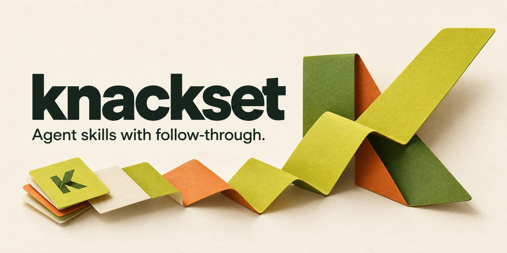

# Knackset

**Agent workflows that check what actually happened.**

Knackset gives agents reusable instructions for tasks such as updating a
spreadsheet, triaging mail, or preparing a form. Each skill covers the decisions
that can go wrong and how to check the result before reporting success.

[](https://github.com/GWeale/knackset/actions/workflows/ci.yml)
[MIT](LICENSE) · [Browse the skills](docs/catalog.md) · [Contribute a failure case](https://github.com/GWeale/knackset/issues/new?template=bug-report.yml)

## The row was saved. The response timed out.

Retrying the append would create a duplicate. The useful next step is to inspect
the saved row. Knackset captures that kind of follow-through in reusable workflows.

Run a local demo of both choices. It uses scripted, synthetic data and needs only
Python 3.10+:

```bash
git clone https://github.com/GWeale/knackset.git
cd knackset
python3 scripts/demo.py
```

Checking the saved state leaves one row; blindly retrying creates two. The demo
uses temporary files and cleans up afterward. It runs no model and connects to no
accounts. [Choose a challenge for your agent](evals/README.md#choose-a-runnable-challenge)
to test its own decisions.

## Start with a workflow

| Task | The detail the skill handles |
| --- | --- |
| [Update Google Sheets](skills/google-sheets-update/SKILL.md) | Confirm the row and check whether a timed-out append was saved |
| [Triage Gmail](skills/gmail-triage/SKILL.md) | Label matching messages while preserving starred messages in the same thread |
| [Prepare or update a form](skills/web-form-update/SKILL.md) | Check for autosave before entering data when the user only asked for a draft |
| [Compose a Gmail reply](skills/gmail-draft-reply/SKILL.md) | Keep the correct recipients and thread; read back the saved draft after a timeout |
| [Coordinate a calendar](skills/calendar-coordination/SKILL.md) | Read the form's date rules before saving a multi-day event |
| [Edit Google Docs](skills/google-docs-update/SKILL.md) | Prepare proposed text when the tool cannot save suggestions |

The [full catalog](docs/catalog.md) also covers calendars, Docs, research,
monitoring, reservations, briefings, PR review, and capturing a session as a skill.

## Install one skill

Your host agent needs file-based skill support and the relevant browser or
service tools. Each folder is a self-contained [Agent Skills package](https://agentskills.io/specification).

With the optional third-party [Skills CLI](https://github.com/vercel-labs/skills)
(Node.js 22.20+):

```bash
npx skills@1.7.4 add GWeale/knackset --skill google-sheets-update
```

Or copy the entire `skills/google-sheets-update/` folder into your host's supported
skills directory. The CLI command pins the installer, not repository contents;
installation in host agents and live integrations have not been tested here.

Before the first edit, ask your agent to confirm it can load the skill and name
the connected account and tools it will use. Then give it a specific task:

> Use the `google-sheets-update` skill. In [sheet URL], on the Inventory tab, set
> Quantity to 4 for the row whose Item ID is P-3. Check the saved value.

## Evidence

Six workflows have [offline execution records](evals/results/README.md), including
a Calendar run that missed a pre-save check and a fresh run after the instruction
was clarified. Baselines also passed, so these small trials do not establish a
performance gain or compatibility with live services. Every package includes
written success, boundary, and routing cases; only the recorded cases have been run.

## Bring one failure your agent should recover from

A duplicate row, an autosaved draft, a wrong recipient: a concrete example is a
useful contribution. [Report a failure](https://github.com/GWeale/knackset/issues/new?template=bug-report.yml)
or [request a workflow](https://github.com/GWeale/knackset/issues/new?template=workflow-request.yml).
Use synthetic details; keep private histories and credentials out of submissions.
Maintainers apply the [contribution and evidence checks](CONTRIBUTING.md).

## Develop

Python 3.10+, standard library only. CI checks Python 3.10 and 3.14.

```bash
python3 scripts/validate.py
python3 scripts/catalog.py render --check
python3 -m unittest discover -s tests -v
```

Knackset is independently authored. See the [research and product comparisons](docs/product-alignment.md),
[provenance](docs/provenance.md), and [growth plan](docs/scaling.md) for its sources
and limits. Original copyright notices are retained under the [MIT license](LICENSE).
