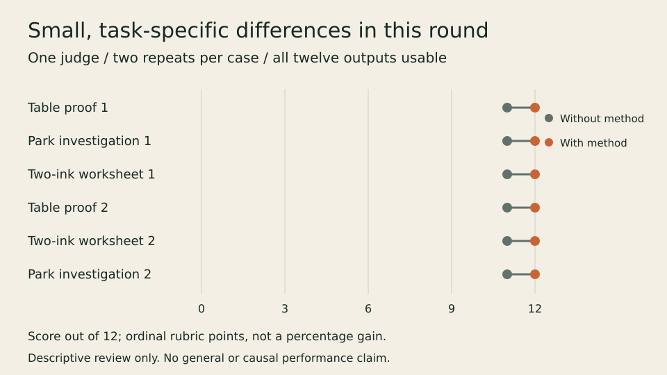

# What the harder round showed

Twelve fresh-context artifacts form six matched pairs: two repetitions of each
of three supplied-source tasks. A separate fresh reviewer judged anonymous pairs
before the mapping was opened. All twelve outputs were usable, with no critical
defects found. The single reviewer preferred the assigned-method output in all
six pairs, by one ordinal rubric point each time. All three separate boundary
responses passed.

| Case | Repetitions | Without / with method | Concrete basis of preference |
| --- | --- | --- | --- |
| Park investigation | 2 | 11 / 12 each | A concrete monthly-count/access comparison that could test the remaining causal account. Both variants corrected the headline and arithmetic. |
| Two-ink worksheet | 2 | 11 / 12 each | More integrated observation targets; in one pair, more writing rules. Both variants preserved the print and identity constraints. |
| Offline table proof | 2 | 11 / 12 each | Larger essential source copy; in one pair, a larger response area. Both variants finished useful proofs without unavailable dependencies. |

These are descriptive judgments on three selected jobs, not six independent task
domains or a population success rate. Scores are ordinal rubric points. The
remaining high scores and shared judge/model limit what small differences mean.
Do not turn 12 versus 11 into a percentage improvement or a general win rate.
The [earlier mixed pilot](../../../examples/launch-study/RESULTS.md) remains
unchanged and must not be erased by this more favorable round.

## What changed

No instruction defect was demonstrated. The three method entrypoints are
unchanged; we did not add rules merely to make a selected case win. New canonical
cases, raw source packs and clearer provenance make future checks repeatable.

Two defects in the new mechanical checker were repaired before interpreting its
results: relative line wraps were initially concatenated, then an overbroad
absolute-y fix could invent or remove word spacing. Preserved versions, a real
false-failure receipt and CLI regressions distinguish instrument faults from
producer faults. All sixteen corrected narrow artifact checks pass. The checker
does not grade art, prose meaning, arbitrary text layout or physical use.

## What this does not establish

There is one producing model, one model judge and two repeats per case. Source
packs and work requests were selected to exercise the methods. The offline case
is transfer coverage of an existing blocked-dependency pattern, not a new class
of problem. This is not the five-repeat stateful sandbox protocol.

Variant labels were withheld, but blinding was imperfect. One output mentioned
an unavailable optional method-status resource; workflow-shaped sections and
uneven check records could also cue treatment. The reviewer reported no identity
inference. No extra credit was given for self-reported route exploration, source
read order or historical inspections without traces. The limitations still
prevent a strong causal claim.

No physical print/pen/reader trial, cross-editor check, live agency-method audit
or installed-host discovery was performed. Complete tool/read traces, billing
cost and comparable token/time accounting were unavailable. Shared-filesystem
isolation was instructed, not enforced. No outside-human feedback was collected
by this round, and the methods remain draft.

[Original judge JSON](judgment.json) · [Original verdict text](judgment-original.md.txt) ·
[Readable verdict](review.md) · [Variant key](anonymous-key.json) ·
[Freeze](freeze.json) · [Rubric](rubric.json) ·
[Instrument correction](instrument-correction.json) ·
[Provenance correction](provenance-correction.json).
