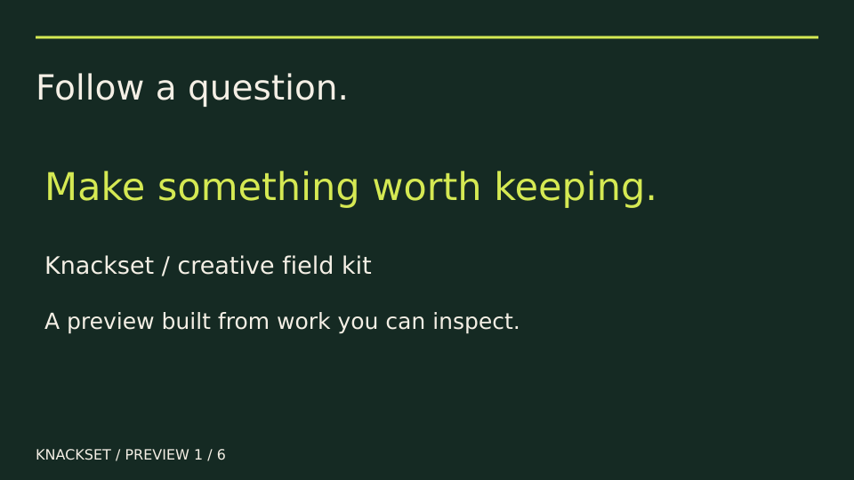

# Follow a question. Make something worth keeping.



This six-frame, 80-second GIF presents saved outputs from the
[actual-project pilot](../launch-study/README.md). It is an assembled captioned
presentation, not a screen recording, live agent replay, audio narration or user
test. It loops. [Suggested narration](NARRATION.md).

The card on the left was made without the Knackset skill; the card on the right
used Reference Remix. Both editable sources and their original notes remain in
the pilot. The investigation and demo packets are linked there too. The package
methods remain draft, and a small pilot does not establish general improvement.

## Inspect or rebuild

Open the six numbered PNGs for still frames or the SVGs for editable layouts.
`build_demo.py` rebuilds them and the GIF using optional installed Pillow, librsvg,
Cairo and DejaVu Sans. No tool is downloaded by that script. These build tools
are not required to install or use the skill packages.

```bash
python3 examples/creative-preview/build_demo.py
```

The builder reads both saved card PNGs, renders the six SVG frames, and reopens
the GIF to check dimensions, frame count and duration. The parent also inspected
the still frames locally. No browser/native capture or cross-viewer playback
test was performed. Human pacing, comprehension and appeal remain open checks.

[Try one method and report what happened](../../docs/try-the-field-kit.md).
