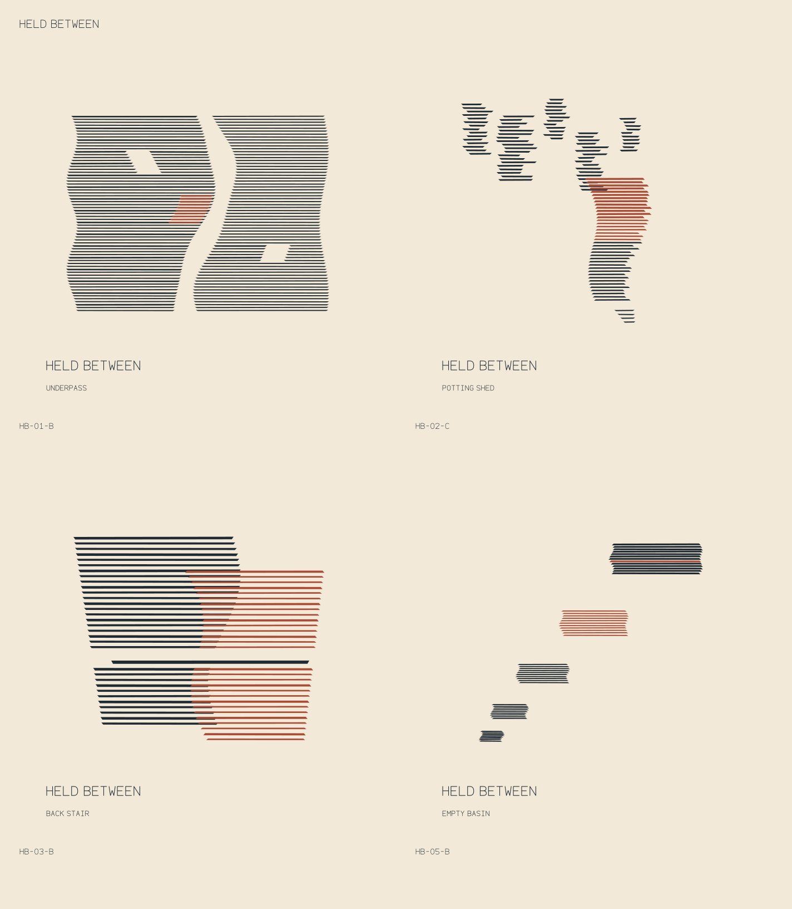
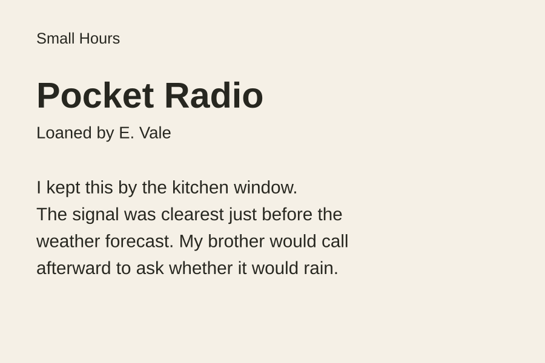

# Three new methods and two refactor boundaries

Produced 2026-11-01, America/Los_Angeles, from fictional material. There is one
fresh agent context per task, no baseline, and no efficacy claim. The three new
methods remain draft. [Review and input hashes](../../evals/results/expansion-review-20261101.md).

## Generative Series: Held Between

Eighteen actual candidates became a four-piece edition. The set varies continuous
fields, clusters, overlap and diminishing returns while retaining its geometry,
palette and lettering. The [selection notes](generative-series/README.md) explain
why particular pieces belong together and why others were left out.

[SVG overview](generative-series/overview.svg) · [editable generator](generative-series/generate.py) ·
[reproduction manifest](generative-series/manifest.json) ·
[raw brief](../../skills/generative-series/evals/files/listening-brief.md) ·
[fictional field records](../../skills/generative-series/evals/files/field-records.csv).

The artist agent rendered the candidates with existing local libraries. The parent
inspected the selected overview and an individual card, checked reproduction, and
reviewed the source. No browser, downloaded font or new dependency was needed.
Physical printing and another renderer remain untested. These are visual responses
to observer notes, not acoustic charts.

## Decision Archaeology: why the board stays collapsed

The initial assumption is rendering performance. The contemporary record instead
points to workshop continuity; a later benchmark is relevant to today's change,
but cannot establish the original motive.
[Explanation](decision-archaeology/explanation.md) ·
[evidence trail](decision-archaeology/evidence-trail.md) ·
[raw source](../../skills/decision-archaeology/evals/files/board-source.txt) ·
[history](../../skills/decision-archaeology/evals/files/board-history.txt) ·
[records](../../skills/decision-archaeology/evals/files/board-records.md).

No real repository, product or performance trial was run. The agent separates
what was implemented, why adoption was documented, later accounts and unknowns.

## Unstick Project: Pocket Radio

The project had spent three evenings on a CMS, a custom font and a photograph
without cleared rights. The immediate request was one 150 × 100 mm label proof.
The result uses the approved story, available typography and fixed identity.
[Editable SVG](unstick-project/pocket-radio-proof.svg) ·
[printable PDF](unstick-project/pocket-radio-proof.pdf) ·
[generator](unstick-project/build_proof.py) ·
[notebook](../../skills/unstick-project/evals/files/exhibit-notebook.md).

The author checked a rendered PDF. The parent subsequently rendered the unchanged
SVG directly and inspected it. No clipping or overlapping copy was seen in those
digital previews. Physical size, printing, visitor comprehension and photo rights
remain separate checks. The original author's [checks](unstick-project/checks.json)
are retained and do not claim that later parent inspection.

## Session capture: amend the method that already exists

The [amended export method](capture-amendment/amended-method.md) preserves editable
text and adds a conditional check for font substitution. It does not create a
universal outlining skill. This is a local draft from supplied fictional notes,
not a newly installed package or an independently rendered typography test.
[Existing method](../../skills/session-to-skill/evals/files/existing-export-method.md) ·
[observations](../../skills/session-to-skill/evals/files/export-session-notes.md).

## Bug reproduction: reduce without inventing a replay

The [evidence pack](repro-records/evidence-pack.md) removes incidental navigation
using already-recorded attempts and retains the reporter's role. It distinguishes
a same-role input change from an administrator's successful attempt.
[Recorded attempts](../../skills/browser-bug-reproduction/evals/files/recorded-attempts.md).

This is an analysis of supplied observations, with no new replay claimed. The
separate bound persistence retest actually performed save/reopen attempts and a
one-character input reduction; see the [retest record](../../evals/results/refactor-retests-20261101.json).
