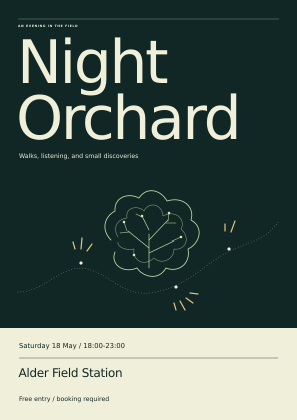

# Six briefs, six things to inspect

These are actual agent outputs from supplied fictional material, produced on
2026-11-01 (America/Los_Angeles). The aim was to see whether the new methods
produce something worth keeping. There is one trial per skill, no baseline, and
no measured improvement claim. All six packages remain **draft**.

## Reference Remix: Night Orchard

An A3 poster built from three descriptions of imaginary references. The night
field controls the composition; a choir-page rhythm becomes listening stops;
the shipping-label treatment is left out. [Editable SVG](reference-remix/night-orchard.svg) ·
[decisions](reference-remix/decisions.md) · [parent's render review](reference-remix/parent-review.md).

The author delivered an unrendered SVG. The parent later rendered the unchanged
source with installed librsvg/cairo and inspected two digital sizes. It has not
been printed. These were textual studies, not visual references the agent opened.
[Brief](../../skills/reference-remix/evals/files/brief.md) ·
[reference studies](../../skills/reference-remix/evals/files/reference-studies.md).

## Rabbit Hole: the cinema that doubled

The attractive story is that a midnight club doubled attendance. The operating
return also shows twice as many screenings, with the same average admissions
per screening. [Read the account](rabbit-hole/account.md) and its
[evidence trail](rabbit-hole/evidence-trail.md).

The conclusion preserves the club's contribution without assigning an unmeasured
causal effect. All source names, URLs and events are fictional. No link was
retrieved. [Source packet](../../skills/rabbit-hole/evals/files/cinema-sources.md).

## Story Mining: Twelve chairs

A repair table begins with five visitors and twelve chairs. Its useful turn is
a visitor asking to hold a screw tray. [Read the finished piece](story-mining/piece.md)
and the separate [source notes](story-mining/source-notes.md).

Counts, failed repairs, current schedule, the lamp's owner and the speaker's
practical rhythm were checked against the fictional
[interview](../../skills/story-mining/evals/files/interview.md) and
[voice sample](../../skills/story-mining/evals/files/voice-sample.md).
The piece is an edited first-person draft, not a verbatim transcript.

## Idea Pressure Test: before two weekends disappear

The proposed app recommends an evening from saved links. The supplied notes
suggest that availability and explicit commitments may matter more than ranking.
The [decision brief](idea-pressure-test/decision-brief.md) proposes a small manual
probe and explains what it could—and could not—establish.

Its thresholds are prospective judgments for a small investment decision, not
market benchmarks. No one was contacted and no customer trial took place.
[Notebook](../../skills/idea-pressure-test/evals/files/evening-plan-notes.md).

## Learn by Making: a control point is not a stop

[The runnable experiment](learn-by-making/experiment.py) generates a two-panel
[SVG](learn-by-making/bezier-experiment.svg), [PNG preview](learn-by-making/bezier-experiment.png)
and [calculated results](learn-by-making/results.json). The
[notes](learn-by-making/experiment-notes.md) explain how to change one parameter,
compare, and reset. [Learner brief](../../skills/learn-by-making/evals/files/learner-brief.md).

Control heights of 200 and 100 produce maximum curve heights of 100 and 50 in
this setup. The agent ran the script; the parent independently reran it and
rendered the SVG. A working demonstration does not establish learner understanding.

## Demo Director: show what the total includes

A 40-second silent sequence follows a category filter from four records totaling
$187 to two Repairs records totaling $140, then restores the full list.
[Script](demo-director/script.md) · [storyboard](demo-director/storyboard.md) ·
[captions](demo-director/captions.vtt) · [editable HTML animatic](demo-director/animatic.html).

The animatic is a labeled source-based simulation, not a screen recording.
Browser rendering, playback and video export were not performed. Cloud sync
remains unavailable; no file import is invented.
[Production brief](../../skills/demo-director/evals/files/production-brief.md) ·
[fixture source](../../skills/demo-director/evals/files/quiet-ledger.html).

## Read the limits with the examples

The [review record](../../evals/results/field-kit-review-20261101.md) records exact
inputs, checks, reviewer judgments and remaining gaps. Outputs are retained as
produced apart from project-relative learning run commands, a labeled parent
follow-up, and whitespace-only cleanup in the SVG generator and its output.
Parent-created PNGs and review notes are identified separately. No private
session material or upstream assets were used in these examples.
