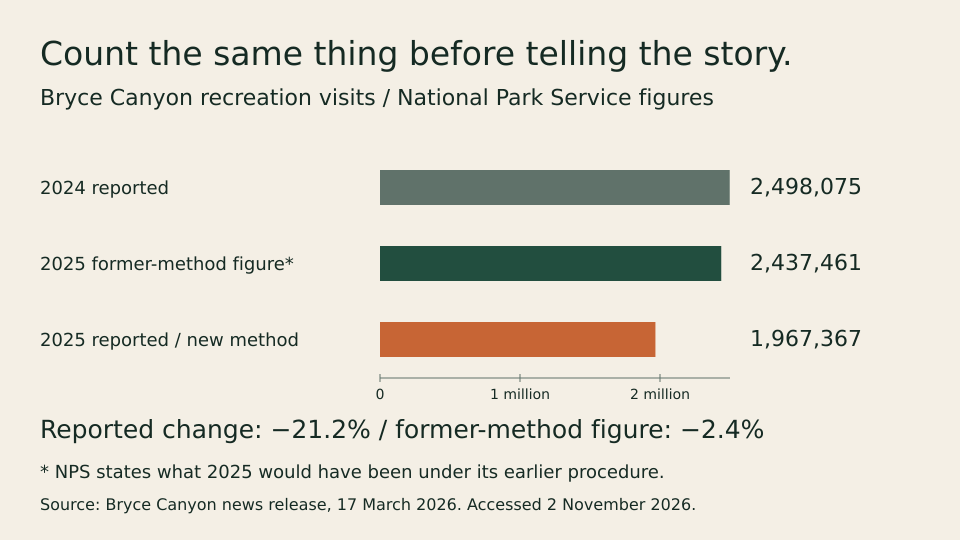
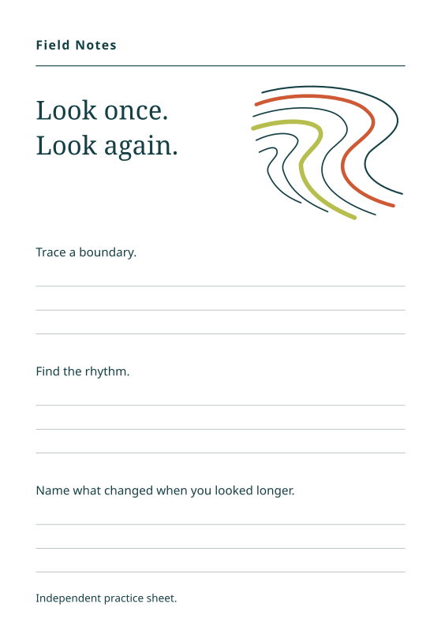

# The counting method changes the park story

The authored newsletter request began with a tempting sentence: “Bryce Canyon
lost one visitor in five in 2025.” The raw figures have that numerical shape.
The question is what was counted.

In its [March 17, 2026 release](https://home.nps.gov/brca/learn/news/2026-03-17-visitation-stats.htm),
Bryce Canyon reports 2,498,075 recreation visits in 2024 and 1,967,367 in 2025.
It also states that 2025 would have been 2,437,461 under its previous procedure.
The new method removes repeated shuttle boardings from the earlier approach.

The important move is to hold the counting procedure consistent before explaining
the change. The published totals fall 21.2%. Using the park's former-method
figure, the change is 2.4%. The agency's reconstruction accounts arithmetically
for most of the headline gap; it is not an independent audit or proof that the
remaining difference measures travel demand alone. Neither figure counts distinct
people across an entire year. The supplied sources do not isolate the shutdown's
effect or another cause of the smaller decline.

## What the agent actually made

[Read the first method-assisted account](editions/parks-01-south/account.md) and
its [source trail](editions/parks-01-south/source-trail.md). It finishes the
newsletter explanation and makes the unresolved question concrete: obtain
consistently counted monthly entries alongside documented access changes.

The [unassisted account](editions/parks-01-north/account.md) also corrected the
headline and computed the figures accurately. The [repeat](editions/parks-02-south/account.md)
and its [unassisted counterpart](editions/parks-02-north/account.md) are retained.
The single anonymous reviewer preferred the method arms for the concrete next
investigation. That is a limited editorial difference on one task, not evidence
of a general success-rate or cost advantage.

## A second kind of finish

Reference Remix worked from three actual USGS images to create an original
[editable color worksheet](editions/patterns-02-north/color.svg) and a
[one-black-ink version](editions/patterns-02-north/ink.svg). The authors chose a
shared observation target and kept space for handwriting. The
[unassisted version](editions/patterns-02-south/color.svg) is also usable; both
meet the physical format, copy and ink constraints.

These are independent practice sheets. The source photographs and agency marks
were not pasted into the vector artwork, and no official affiliation or common
scientific color key is claimed. Native rendering and inspection checked the
saved files. Physical printing, handwriting and reader response remain untested.

The [table-proof task](editions/offline-02-south/proof.svg) similarly finished one
useful local artifact with available material while preserving unresolved access
and rights. It did not upload anything or make those dependencies disappear.

## Try the decision on your own work

Bring a source disagreement, a folder of references or a stalled project. Ask for
the artifact you need, preserve the commitments that matter, and inspect the
result. Tell us what you kept, repaired or discarded. The
[field-test guide](../../docs/try-the-field-kit.md) distinguishes own-project
reports from guided exercises; no outside-human reports are implied here.

The task scenarios are authored. The NPS/USGS material is real and attributed.
The graph above is a coordinator-authored illustration of the supplied figures,
not a measurement of skill effectiveness. The
[full round](../../evals/results/field-round-20261102/RESULTS.md) retains all
outputs, the frozen criteria, preferences, instrument faults and limitations.
