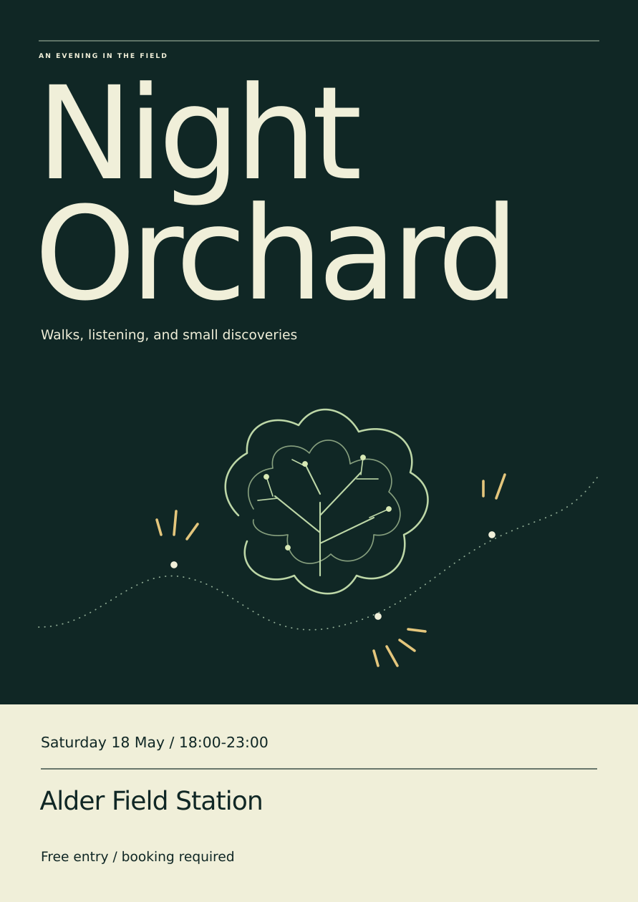

# Night Orchard: a creative proof you can inspect

**Reference Remix produced this fictional event poster.** The supplied repository describes the work as an actual agent output from three fictional textual reference descriptions. This packet presents that existing output; it does not claim a new execution of Reference Remix.

[Open the unchanged editable SVG](assets/night-orchard.svg) · [Read the 60–90 second narration](NARRATION.md) · [Try one bounded first task](FIRST-TASK.md)

## What to look at

The brief is an evening of orchard walks, sound installations and conversations with field scientists. The title gives it an immediate identity. An open tree crown and a dotted route suggest observation and movement. The pale lower band separates the practical details from the atmospheric field. These are observations of the supplied artwork, not a reconstruction of the original agent's reasoning.

The event is fictional. The date, venue and booking line are specimen copy, not a current event or a working booking offer.

## What the source trail supports

| Material | What it establishes | What it cannot establish |
| --- | --- | --- |
| Supplied repository README | Attributes Night Orchard to Reference Remix and says it used three fictional reference descriptions. | The contents of those three descriptions, or which reference caused each choice. |
| Supplied examples README | Calls these actual agent outputs from fictional raw material; says initial trials have no comparison baseline and the creative methods remain draft. | General effectiveness, measured gains or outside-user reactions. |
| Poster metadata and description, retained in the SVG | A3 portrait, 297 × 420 mm; original vector art developed from three textual studies; no reference images were available or inspected. Describes the fictional brief. | Image-reference analysis, a full replay or a print-production check. |
| Today's packet | Preserves the poster and icon, provides a local preview, narration and a complete first-task prompt. | A new Reference Remix run, host activation, or a live-service test. |

**The original three textual studies are not among the supplied inputs.** We can inspect the output and its declared origin today. We cannot independently audit the original transformation from those studies. The first task therefore uses the included poster and its brief openly; it does not pretend to replay the missing sources.

For an offline source check, the relevant supplied statements are reproduced below:

> “Reference Remix made this poster from three fictional reference descriptions.” — supplied repository README, “See what came out”

> “These are actual agent outputs from fictional raw material.” “They are initial trials, without comparison baselines or a claim of general effectiveness.” — supplied examples README

> “Developed from three supplied textual reference studies; no reference images were available or inspected.” — unchanged poster metadata

Original supplied files: [repository README](../../../inputs/README.md.txt), [examples README](../../../inputs/examples/README.md.txt), [poster](../../../inputs/examples/field-kit/reference-remix/night-orchard.svg). The material needed to inspect this demo and attempt the first task is included in this folder; those links provide the surrounding source context.

## Why this gets the launch moving

The intended outcome was a reviewable creative demonstration. The blocked approach made live Google accounts and five outside testers prerequisites for showing anything. They are dependencies for different claims: live accounts for live-service behavior, people for comprehension and usefulness feedback. Neither is necessary to inspect this existing poster locally.

The smallest complete move is this poster-first packet. It preserves the repository's icon and artwork and carries the evidence limits with them. The supplied [published alpha snapshot](../../../inputs/published-alpha.md.txt) still describes office workflows. Its [Gmail/Sheets comparison](../../../inputs/evals/results/comparison-final-20261101/REPORT.md.txt) is evidence about those offline tasks; its scores do not validate this creative method. No release, repository page or existing demo was changed.

## Review it now

1. Open the poster preview or SVG. Check whether the event idea and practical information are legible.
2. Read the narration aloud while showing the poster, then point to the source-limit paragraph above.
3. Try the [square-companion task](FIRST-TASK.md) using the included asset and brief. Stop at one inspectable draft.

**The next consequential decision belongs to George:** is this honest, poster-first proof suitable as the creative lead of the next launch draft? If yes, the next authorized work is to adapt the launch copy around this packet and its stated limits. Publication is a separate action. Before claiming the original references are fully inspectable, recover the three original studies. Before claiming audience comprehension or usefulness, obtain and record actual human feedback; five testers are not evidence until they have tried it.

[What was actually checked, and remaining gaps](CHECKS.md)
